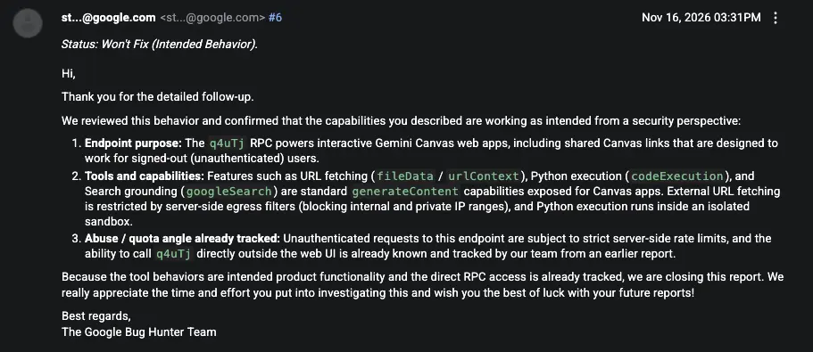

# Gemini RPC

> [!WARNING]
> Disclaimer: This project is an unofficial wrapper around Google's internal RPC endpoint and is not affiliated with, endorsed by, or officially supported by Google in any capacity, subject to rate limits and server-side egress filters that may change without notice, and is provided on an as-is basis with no warranty of availability, so use it at your own risk and please do not abuse the service.

<div align='center'>



</div>

## Installation

```bash
git clone https://github.com/NeaByteLab/Gemini-RPC.git
cd Gemini-RPC/
```

## Usage

Import the library with a single default export that gives you access to all 8 static methods, each designed for a specific use case and returning predictable output formats.

```ts
import RPC from '@neabyte/gemini-rpc'
```

### generateText

Generate natural language responses from plain text prompts, returning the model's response as a plain string.

```ts
const response = await RPC.generateText('What is the meaning of life?')
// Output: "The meaning of life is a philosophical question that has been debated..."
```

### generateImage

Generate images from text descriptions and return them as base64-encoded JPEG strings that you can decode and save directly to disk.

```ts
const base64Image = await RPC.generateImage('A pixel art cat wearing sunglasses')
// Output: "/9j/4AAQSkZJRgABAQEA..." (base64 string, typically 500KB-2MB)
```

### generateAudio

Convert text to speech using Google's TTS models, returning base64-encoded PCM audio at 24kHz with a choice of 6 different voice profiles.

```ts
const base64Audio = await RPC.generateAudio('Hello world', 'Kore')
// Output: "UklGRjQEAABXQVZFZm10IBAA..." (base64 string, PCM 24kHz)
// Available voices: Kore, Puck, Charon, Fenrir, Aoede, Leda
```

### generateJSON

Generate structured JSON output validated against a schema, returning a typed object that matches your specification exactly.

```ts
const data = await RPC.generateJSON('List 3 programming languages with their creation year', {
  type: 'ARRAY',
  items: {
    type: 'OBJECT',
    properties: {
      name: { type: 'STRING' },
      year: { type: 'NUMBER' }
    }
  }
})
// Output: [{ name: "Python", year: 1991 }, { name: "JavaScript", year: 1995 }, ...]
```

### search

Perform web searches with Google's search grounding tool, returning a text response grounded in current web results.

```ts
const answer = await RPC.search('What is the capital of France?')
// Output: "The capital of France is Paris, a city known for the Eiffel Tower..."
```

### fetch

Fetch external URLs and process their content with an instruction, returning the model's processed output as a string.

```ts
const summary = await RPC.fetch('Summarize this page in 2 sentences', 'https://example.com')
// Output: "This is a placeholder domain for documentation examples..."
```

### sandbox

Execute Python or JavaScript code in Google's isolated sandbox environment, returning the stdout output as a string.

```ts
const result = await RPC.sandbox('Calculate the factorial of 5', 'print(5 * 4 * 3 * 2 * 1)')
// Output: "120"
```

### invoke

Invoke structured function calls with typed parameters, returning an object with the function name, arguments, and a unique call ID.

```ts
const functionCall = await RPC.invoke('What is the weather in Tokyo?', [
  {
    name: 'get_weather',
    description: 'Get current weather for a city',
    parameters: {
      type: 'OBJECT',
      properties: { city: { type: 'STRING' } },
      required: ['city']
    }
  }
])
// Output: { name: "get_weather", args: { city: "Tokyo" }, id: "call_123456789" }
```

## License

This project is licensed under the [MIT License](./LICENSE).
